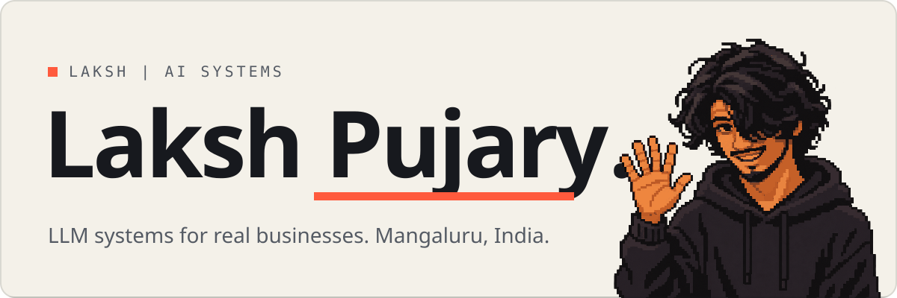

 

 

## About

I build LLM systems for small businesses, and I care most about one failure mode: **an AI that says it did something it didn't.**

Most of my work is the part around the model: tool boundaries, business rules kept out of the prompt, audit trails, and tests that catch confident wrong answers before a customer hears them.

 

## Featured work

<table>
<tr>
<td width="50%" valign="top">

### [hotel-ai-reception](https://github.com/lakshcode9/hotel-ai-reception)
Self-hosted AI receptionist for a hotel phone line. The model **cannot** report success the backend didn't confirm.

- Tools return `Result<T, E>`, passed to the model verbatim
- Business rules are DB rows that stay inert until a human approves them
- Every state change is audited · 26 tests, one or more per guarantee
- Tests caught a retrieval false positive: *"do you have a helipad?"* matched pool FAQs on the word "have"

  

</td>
<td width="50%" valign="top">

### [guild](https://github.com/lakshcode9/guild)
The full online store for a streetwear retailer in Karnataka.

- Next.js 16 storefront + Django REST API
- Razorpay payments, Shiprocket shipping
- OTP checkout, returns, order management

  

</td>
</tr>
<tr>
<td width="50%" valign="top">

### [trend-brief-engine](https://github.com/lakshcode9/trend-brief-engine)
Automated research pipeline, run on a weekly cron.

- Scores Google Trends + Reddit signals
- Researches each trend with Perplexity
- Renders PDF reports with Puppeteer and publishes them to Gumroad

  

</td>
<td width="50%" valign="top">

### [n8n](https://github.com/lakshcode9/n8n)
Self-hosted n8n on Render, free.

- Custom Dockerfile: ffmpeg, Python, yt-dlp
- Supabase Postgres so workflows survive restarts
- Uptime keep-alive setup

  

</td>
</tr>
</table>

 

## Stack

<b>AI:</b> LLM APIs (OpenAI-compatible, Perplexity, OpenRouter) · tool calling · retrieval · agent orchestration · n8n

 

## Currently

- Learning how to evaluate AI agents and model outputs, and applying for evaluation work
- Doing CS50P alongside an AI engineering curriculum: RAG, embeddings, evals, fine-tuning

 

<a href="https://lakshpujary.tech">lakshpujary.tech</a>

